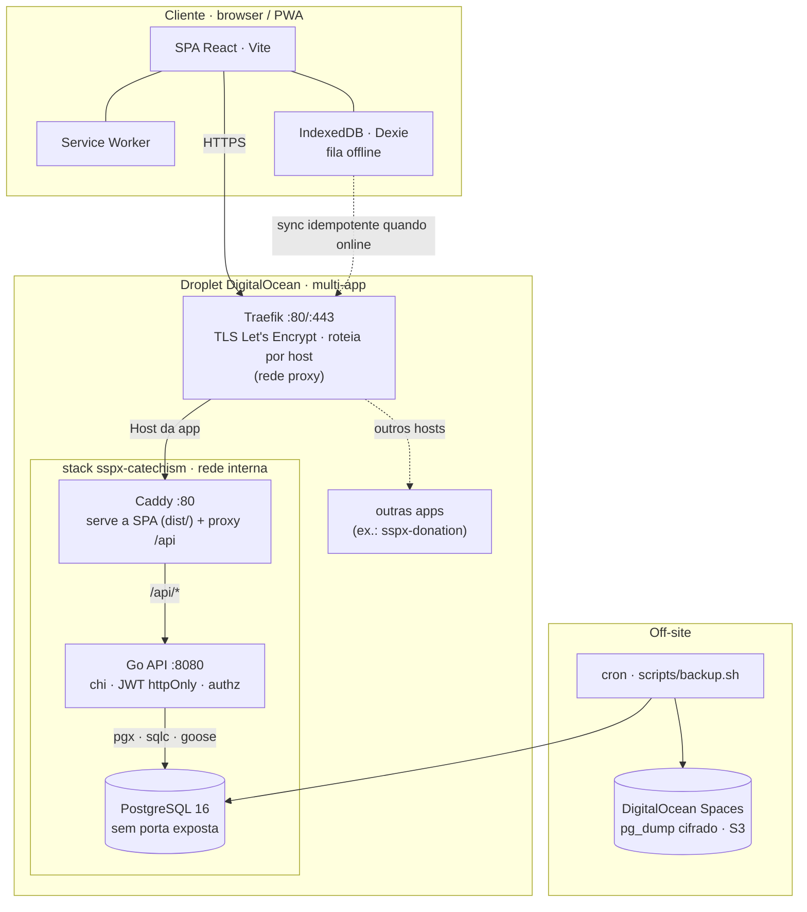
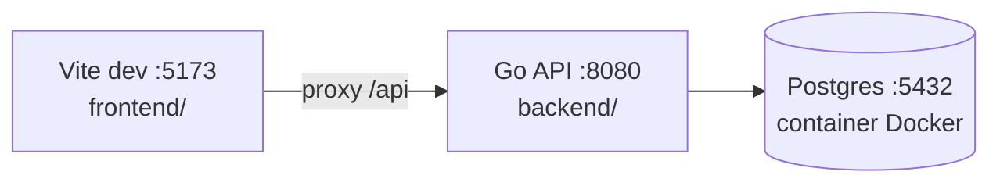
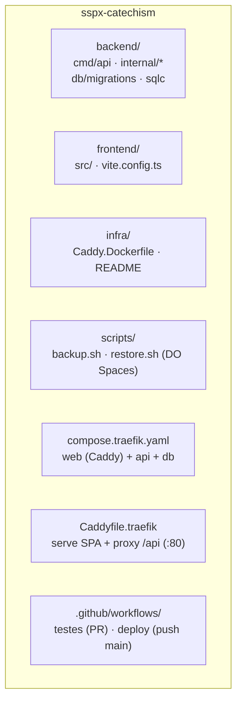

# Catechism — gestão de presença para catecismo

Aplicação web/PWA para **uma paróquia** gerenciar **cadastro de alunos** de catecismo e **chamada de presença** por turma. O foco é substituir listas em papel, centralizar dados pessoais, pastorais e de contato dos responsáveis, e permitir que **catequistas** registrem a chamada no celular — inclusive **offline**, com sincronização automática quando a conexão voltar. **Coordenadores** usam um painel para turmas, alunos e relatórios.

Documentação de produto e arquitetura (fonte da verdade para escopo e stack):

- [PRD](.compozy/tasks/migration-go/_prd.md) — visão, personas, funcionalidades e fases
- [TechSpec](.compozy/tasks/migration-go/_techspec.md) — arquitetura, modelo de dados, APIs e decisões técnicas
- [ADRs](.compozy/tasks/migration-go/adrs/) — decisões de arquitetura (VPS/Docker, SPA Vite, stack Go, JWT/authz, deploy/backup)
- [Runbook de infraestrutura](infra/README.md) — provisionamento do droplet DigitalOcean, deploy e operação

> Nota: os documentos em `.compozy/` são o registro histórico do planejamento da migração (Supabase/Next.js → Go). A stack em produção hoje é a descrita abaixo.

---

## Stack


| Camada         | Tecnologia                                                                                                                                                                            |
| -------------- | ------------------------------------------------------------------------------------------------------------------------------------------------------------------------------------- |
| Frontend       | [Vite](https://vitejs.dev) + React 19 + [React Router](https://reactrouter.com), TypeScript                                                                                           |
| UI             | Tailwind CSS, [shadcn/ui](https://ui.shadcn.com), [Base UI](https://base-ui.com)                                                                                                      |
| Backend / API  | **Go** — [chi](https://github.com/go-chi/chi) (router), [pgx](https://github.com/jackc/pgx) + [sqlc](https://sqlc.dev) (dados), [goose](https://github.com/pressly/goose) (migrações) |
| Banco de dados | **PostgreSQL 16** (auto-hospedado em container)                                                                                                                                       |
| Autenticação   | JWT em cookie httpOnly + bcrypt; autorização na camada de aplicação (substitui o RLS); rate limit no login                                                                            |
| Offline        | PWA ([vite-plugin-pwa](https://vite-pwa-org.netlify.app)), [Dexie](https://dexie.org) (IndexedDB)                                                                                     |
| Relatórios     | Geração de PDF/XLSX no backend Go                                                                                                                                                     |
| Edge / TLS     | [Traefik](https://traefik.io) compartilhado (HTTPS Let's Encrypt + roteamento por host) → [Caddy](https://caddyserver.com) por app (serve a SPA + proxy `/api`)                       |
| Empacotamento  | Docker Compose                                                                                                                                                                        |
| Deploy         | Droplet [DigitalOcean](https://www.digitalocean.com) (multi-app, Traefik compartilhado) + GitHub Actions → SSH; backup em [DigitalOcean Spaces](https://www.digitalocean.com/products/spaces) |


---

## Arquitetura

A app roda num **droplet DigitalOcean** que hospeda **várias aplicações** atrás de um **Traefik compartilhado**. Cada app é um projeto Docker Compose em `/opt/apps/projects/<app>`; o Traefik (em `/opt/apps/proxy`) termina o TLS e roteia por hostname via a rede Docker externa `proxy`.

### Produção (droplet DigitalOcean)



Fluxo de uma requisição: o cliente fala HTTPS com o **Traefik**, que roteia pelo hostname até o **Caddy** da app (rede `proxy`). O Caddy serve os estáticos da SPA e faz proxy de `/api/*` para a **API Go**, que acessa o **Postgres** na rede interna do stack. O Postgres não expõe porta ao host.

### Desenvolvimento local



Em local não há Traefik/Caddy: o Vite dev server faz proxy de `/api` direto para a API Go.

### Layout do monorepo



---

## Regras e princípios principais

- **Papéis:** **admin** — acesso total, gestão de catequistas e anos letivos; **coordenador** — turmas, alunos, catequistas, relatórios; **catequista** — apenas turmas às quais está vinculado, chamada e histórico. O acesso é reforçado **na camada de aplicação (API Go)** — as regras que antes eram RLS no Supabase agora vivem no backend (`internal/authz`).
- **Offline-first na chamada:** a fila fica no dispositivo (IndexedDB/Dexie) e tenta enviar ao servidor ao voltar online; em Safari/iOS o **Background Sync** pode ser limitado — há fallback com o evento `online`. A sincronização é **idempotente** (reenviar o mesmo lote não duplica presenças).
- **LGPD:** dados de menores e responsáveis são sensíveis; apenas usuários autorizados devem acessar o sistema. Tráfego sob HTTPS, senhas com hash bcrypt e backups cifrados.
- **Escopo do MVP:** uma paróquia, sem portal para pais, sem notificações automáticas de falta, sem multi-paróquia (detalhes em *Non-Goals* do PRD).
- **Linguagem da UI:** português brasileiro, vocabulário paroquial (turma, catequista, aluno).
- **Segredos:** apenas no servidor (`.env` ao lado do `compose.traefik.yaml`, em `/opt/apps/projects/sspx-catechism`) — `JWT_SECRET`, credenciais do Postgres, `ADMIN_EMAIL`/`ADMIN_PASSWORD`, credenciais do DigitalOcean Spaces. Nunca commitados.

---

## Desenvolvimento local

Pré-requisitos: **Go 1.25+**, **Node 22** (fixado em `.nvmrc`; use `fnm`/`nvm` para trocar), **Docker** (para um Postgres local).

### 1. Banco de dados (Postgres em container)

```bash
docker run -d --name catechism-db \
  -e POSTGRES_USER=cat -e POSTGRES_PASSWORD=cat -e POSTGRES_DB=cat \
  -p 5432:5432 postgres:16-alpine
```

### 2. Backend (API Go)

```bash
cd backend
cp .env.example .env   # ajuste se precisar; o `.env` não é versionado
go run ./cmd/api       # aplica migrações (goose), semeia o admin e sobe em :8080
```

O backend carrega automaticamente `backend/.env` no startup (variáveis já definidas no shell ou no Docker têm prioridade).

As migrações em `backend/db/migrations/` são aplicadas automaticamente no startup. Para regenerar o acesso a dados após alterar SQL: `sqlc generate` (em `backend/`).

### 3. Frontend (SPA Vite)

```bash
cd frontend
npm install
npm run dev           # Vite em :5173, chamando a API em /api
```

---

## Build e testes


| Onde        | Comando                 | Descrição                       |
| ----------- | ----------------------- | ------------------------------- |
| `backend/`  | `go build ./...`        | Compila a API                   |
| `backend/`  | `go vet ./...`          | Análise estática                |
| `backend/`  | `go test ./...`         | Testes (unitários + integração) |
| `frontend/` | `npm run build`         | Type-check + build de produção  |
| `frontend/` | `npm run lint`          | Type-check (`tsc -b`)           |
| `frontend/` | `npm test`              | Testes Vitest                   |
| `frontend/` | `npm run test:coverage` | Vitest com cobertura            |


Os testes de integração do backend exigem um Postgres real: eles são **pulados** a menos que `TEST_DATABASE_URL` aponte para um banco (ex.: o container de dev acima). Os testes unitários rodam sempre.

---

## Variáveis de ambiente

No servidor, copie [`.env.server.example`](.env.server.example) para `.env` (ao lado do `compose.traefik.yaml`) e preencha:

```bash
POSTGRES_USER=catechism
POSTGRES_PASSWORD=<senha forte>
POSTGRES_DB=catechism
DATABASE_URL=postgres://catechism:<senha>@db:5432/catechism?sslmode=disable
JWT_SECRET=<openssl rand -base64 48>
ADMIN_EMAIL=<email do admin>
ADMIN_PASSWORD=<senha do admin>
# ADMIN_FORCE_RESET=true  # opcional: força reset do admin em um boot (recuperar lockout)
# Backup → DigitalOcean Spaces (S3)
SPACES_BUCKET=catechism-backups
SPACES_REGION=nyc3
AWS_ACCESS_KEY_ID=<Spaces access key>
AWS_SECRET_ACCESS_KEY=<Spaces secret key>
BACKUP_PASSPHRASE=<passphrase de cifragem>
```

O hostname público e o TLS são resolvidos pelo **Traefik compartilhado** (o host fica nas labels do `compose.traefik.yaml`), por isso não há variável `DOMAIN`.

O **admin** é provisionado ao iniciar a API **apenas se não existir** (lendo `ADMIN_EMAIL`/`ADMIN_PASSWORD`); uma senha trocada no painel não é revertida em deploys. Os demais usuários são criados pelo admin/coordenador no painel.

---

## Deploy (DigitalOcean)

Passo a passo completo em [`infra/README.md`](infra/README.md). Resumo:

1. Ter um droplet DigitalOcean com Docker e o **Traefik compartilhado** rodando (rede externa `proxy`).
2. Apontar o **DNS** do domínio para o IP do droplet (pré-requisito do TLS emitido pelo Traefik).
3. Clonar o repo em `/opt/apps/projects/sspx-catechism`, preencher `.env`.
4. `docker compose -f compose.traefik.yaml up -d --build` → Caddy sobe atrás do Traefik, goose migra, admin é semeado (se ausente).
5. Agendar o backup noturno para o DO Spaces (`scripts/backup.sh` via cron) e **testar a restauração** (`scripts/restore.sh`).
6. CI: cadastrar os secrets SSH no GitHub → `git push` na `main` faz deploy automático (`.github/workflows/deploy.yml`).

---

## Passo a passo: usar no celular (PWA)

A app é instalável como **PWA**. Use a **URL HTTPS** de produção para testar offline e instalação como os utilizadores finais.

**Antes da primeira vez:** com internet, abra o site, faça login e navegue um pouco para o browser cachear o necessário ao modo offline na chamada.

### iPhone e iPad (Safari)

1. Abra a URL da app **no Safari**. No iOS, a instalação na tela inicial costuma funcionar melhor pelo Safari.
2. Toque em **Partilhar** (quadrado com seta para cima).
3. Escolha **Adicionar à Tela de Início** → confirme o nome → **Adicionar**.
4. Abra pelo **ícone** — abre em ecrã quase inteiro.

Para **desinstalar**, mantenha o dedo no ícone → **Remover App**.

### Android (Chrome)

1. Abra a URL no **Chrome**.
2. Use o banner **Instalar app** ou o menu **⋮** → **Instalar app**.
3. Confirme e abra pelo **ícone**.

### Uso no dia a dia (catequista)

1. **Com rede:** abra a app, inicie a chamada e registe presenças normalmente.
2. **Sem rede:** se já usou a app online neste telemóvel, continue a marcar presenças; os dados ficam na fila local até haver rede.
3. **Quando a internet voltar:** mantenha a app aberta um momento — a sincronização corre automaticamente (idempotente). No **Safari/iOS** o Background Sync pode ser limitado; abrir a app quando houver rede costuma bastar.
