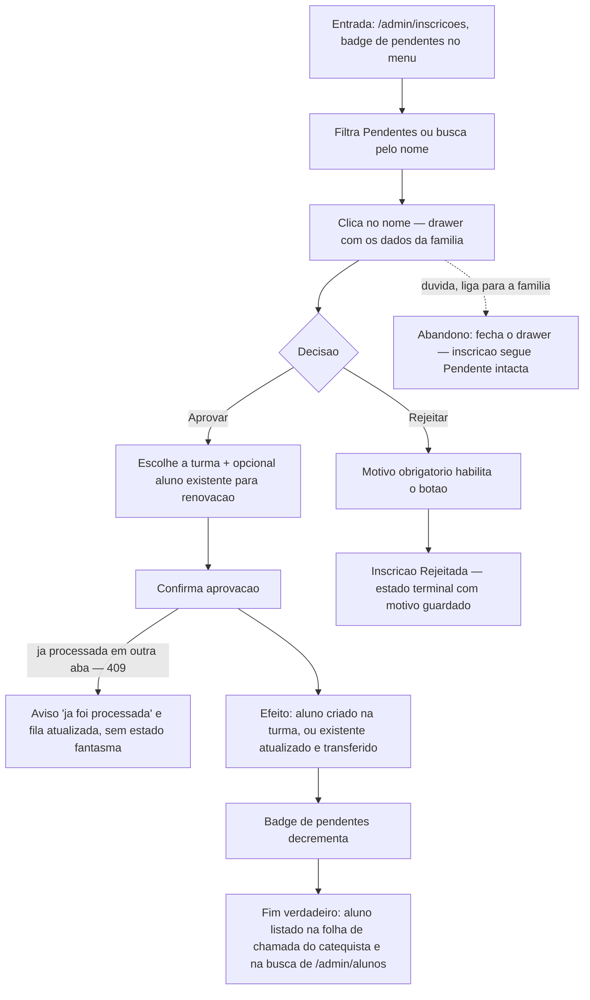

# J-aprovar-inscricao — Revisar a fila e materializar o aluno



```yaml
journey:
  id: J-aprovar-inscricao
  name: Aprovar (ou rejeitar) inscrições da fila
  value_statement: "Cada inscrição vira um aluno na turma certa — ou uma rejeição com motivo — sem duplicar cadastros nem perder ninguém na fila."
  personas: [Anselmo]
  entry_points:
    - url: /admin/inscricoes
      origin: in-app-nav
  actions:
    - step: 1
      verb: Abre a fila pelos Pendentes (badge no menu)
      expected_observable: Lista filtrada por status, busca por nome funciona
    - step: 2
      verb: Abre o drawer de uma inscrição
      expected_observable: Todos os dados enviados pela família, legíveis
    - step: 3
      verb: Aprova escolhendo turma (e aluno existente, se renovação)
      expected_observable: Confirmação; a inscrição sai dos Pendentes
    - step: 4
      verb: Rejeita outra com motivo
      expected_observable: Botão de rejeitar só habilita com motivo preenchido
  goal:
    observable: Inscrição processada (aprovada ou rejeitada) e fila atualizada
    side_effects: [record-created]
  true_end_state: Aluno aprovado aparece na folha de chamada do catequista da turma escolhida e na busca de alunos; rejeitada guarda o motivo; estados são terminais (retentativa → aviso 409).
  exit:
    natural: Fila de pendentes zerada ou reduzida; badge reflete
  abandonment:
    - at_step: 2
      how: Fecha o drawer para confirmar um dado por telefone
      resume: Inscrição continua Pendente com os dados intactos
  crosses: [fila do coordenador → transação de aprovação (FOR UPDATE) → cadastro de alunos → dashboard do catequista]
```
