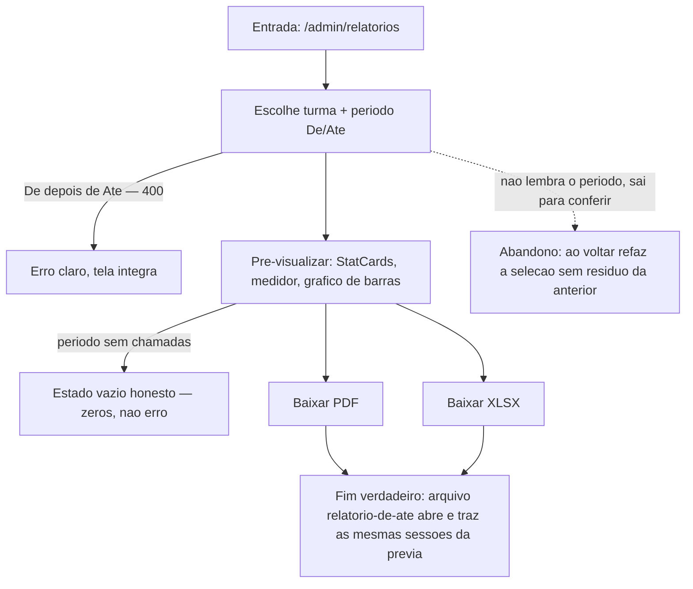

# J-emitir-relatorio — Fechar o período com números confiáveis



```yaml
journey:
  id: J-emitir-relatorio
  name: Emitir o relatório de presença do período
  value_statement: "Os números que o coordenador apresenta à paróquia batem com as chamadas que as catequistas fizeram."
  personas: [Anselmo]
  entry_points:
    - url: /admin/relatorios
      origin: in-app-nav
  actions:
    - step: 1
      verb: Escolhe a turma e o período (De/Até)
      expected_observable: Campos de data claros; período inválido é recusado com aviso
    - step: 2
      verb: Pré-visualiza
      expected_observable: StatCards, medidor e gráfico com os números do período em até 3s
    - step: 3
      verb: Baixa PDF e XLSX
      expected_observable: Download nomeado relatorio-<de>-<até>.<ext>; arquivo abre
  goal:
    observable: Prévia na tela e arquivos baixados
    side_effects: [arquivo-gerado-no-servidor]
  true_end_state: PDF e XLSX trazem as mesmas sessões e totais da prévia — que por sua vez batem com as chamadas sincronizadas do período.
  exit:
    natural: Arquivos no dispositivo; coordenador segue para a reunião
  abandonment:
    - at_step: 1
      how: Sai da tela para conferir o período em outro lugar
      resume: Ao voltar, refaz a seleção; nenhum resíduo confuso da tentativa anterior
  crosses: [chamadas sincronizadas → agregação no backend → geração PDF/XLSX no Go → download no navegador]
```
