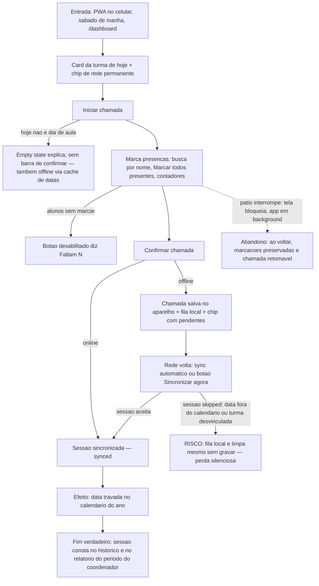

# J-fazer-chamada-offline — Fazer a chamada de sábado (com ou sem rede)



```yaml
journey:
  id: J-fazer-chamada-offline
  name: Fazer e sincronizar a chamada da turma
  value_statement: "A presença marcada no pátio — com a rede que houver — chega intacta ao histórico e ao relatório do coordenador."
  personas: [Tereza, Joaquim]
  entry_points:
    - url: /dashboard
      origin: direct
    - url: /dashboard/turmas/:id/chamada
      origin: in-app-nav
  actions:
    - step: 1
      verb: Abre o dashboard no celular e vê a turma de hoje
      expected_observable: Card da turma, chip de rede visível, botão Iniciar chamada
    - step: 2
      verb: Marca cada aluno (ou Marcar todos presentes, filtrado pela busca)
      expected_observable: Contadores presentes/ausentes/sem marcar e barra de progresso reagem a cada toque
    - step: 3
      verb: Confirma a chamada
      expected_observable: Online → confirmação de envio; offline → "Chamada salva no aparelho. Será enviada quando a conexão retornar."
    - step: 4
      verb: Quando a rede volta, sincroniza (automático ou botão)
      expected_observable: Fila de pendentes zera; chip volta a Online sem pendências
  goal:
    observable: Chamada da turma registrada para a data de hoje
    side_effects: [record-created, data-travada-no-calendario]
  true_end_state: A sessão aparece no histórico (GET /api/attendance) e no relatório do período; reenvio da mesma turma+data não duplica (idempotente); se o servidor descartar (skipped), a catequista é avisada — a chamada não some em silêncio.
  exit:
    natural: Dashboard com "chamada de hoje feita"; fila vazia
  abandonment:
    - at_step: 2
      how: Interrompida no pátio; celular bloqueia ou o app vai para background
      resume: Marcações preservadas ao voltar; chamada retomável do ponto em que parou
  crosses: [PWA/service worker → fila IndexedDB (Dexie) → POST /api/attendance idempotente → calendário (datas travadas) → relatórios]
```
