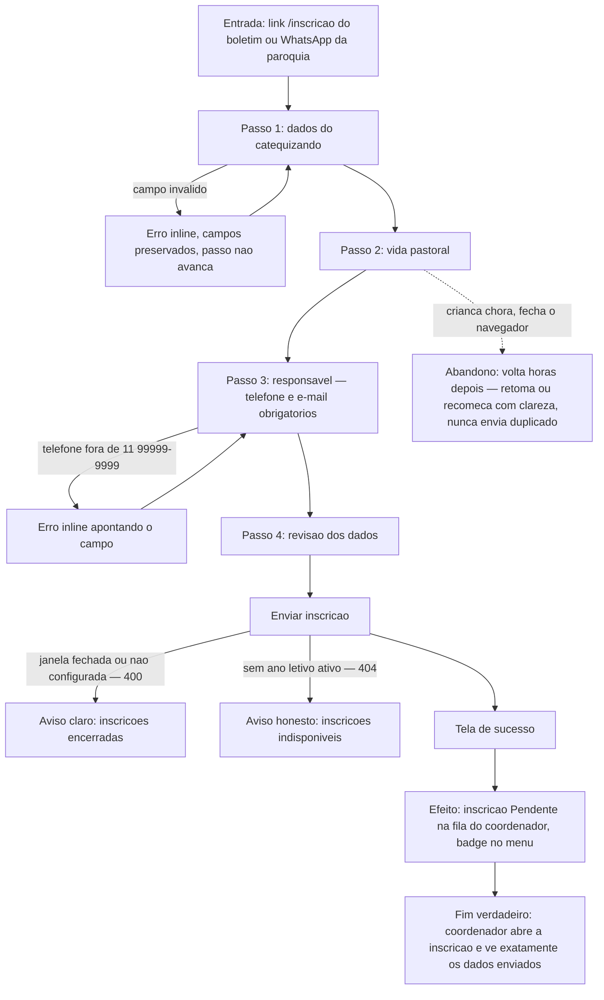

# J-inscrever-catequizando — Inscrever o catequizando pelo formulário público



```yaml
journey:
  id: J-inscrever-catequizando
  name: Inscrever o catequizando na catequese
  value_statement: "A família matricula a criança sem ir à secretaria — e a paróquia recebe os dados completos e legíveis."
  personas: [Marta]
  entry_points:
    - url: /inscricao
      origin: external-share
  actions:
    - step: 1
      verb: Preenche os dados do catequizando (nome, nascimento)
      expected_observable: Stepper marca o passo 1; erros aparecem inline sem apagar o que foi digitado
    - step: 2
      verb: Responde a vida pastoral (catecismo anterior, sacramentos)
      expected_observable: Avança ao passo seguinte mantendo as respostas
    - step: 3
      verb: Informa o responsável (telefone no formato (11) 99999-9999, e-mail)
      expected_observable: Máscara/validação do telefone orienta em vez de só recusar
    - step: 4
      verb: Revisa tudo e envia
      expected_observable: Tela de sucesso em até 3s, sem dúvida se enviou
  goal:
    observable: Tela de sucesso confirmando a inscrição recebida
    side_effects: [record-created]
  true_end_state: A inscrição aparece como Pendente em /admin/inscricoes com todos os dados enviados; o badge de pendentes do coordenador incrementa.
  exit:
    natural: Tela de sucesso; a família fecha o navegador tranquila
  abandonment:
    - at_step: 2
      how: Interrompida pelos filhos, fecha o navegador no meio
      resume: Ao voltar, entende onde está — dados persistidos ou recomeço claro; nunca envio duplicado
  crosses: [formulário público sem auth → API de inscrição → fila do coordenador (ano ativo resolvido no servidor)]
```
