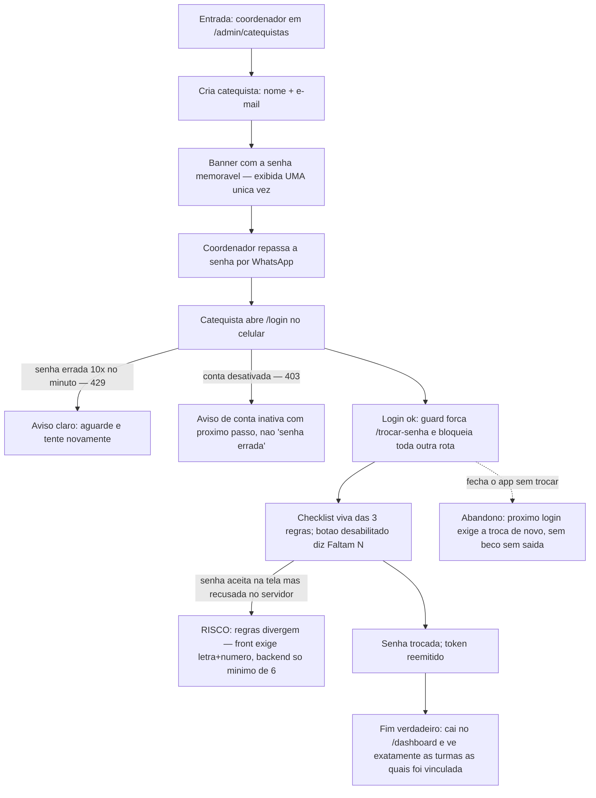

# J-primeiro-acesso-catequista — Da senha provisória ao dashboard



```yaml
journey:
  id: J-primeiro-acesso-catequista
  name: Cadastrar catequista e completar o primeiro acesso
  value_statement: "A catequista nova entra sozinha: senha provisória → troca obrigatória → sua turma na tela, sem chamar o coordenador de volta."
  personas: [Camila, Anselmo]
  entry_points:
    - url: /admin/catequistas
      origin: in-app-nav
    - url: /login
      origin: external-share
  actions:
    - step: 1
      verb: Coordenador cria a catequista (nome + e-mail)
      expected_observable: Banner com a senha provisória, avisando que não será mostrada de novo
    - step: 2
      verb: Catequista faz login com a senha recebida
      expected_observable: Redirecionada à força para /trocar-senha; nenhuma outra rota abre
    - step: 3
      verb: Cria a senha definitiva guiada pela checklist
      expected_observable: Checklist reage ao vivo; botão desabilitado diz "Faltam N"
    - step: 4
      verb: Entra no dashboard
      expected_observable: Apenas as turmas às quais foi vinculada; nada de telas de coordenação
  goal:
    observable: Login com a senha nova cai direto no /dashboard
    side_effects: [record-created, token-reemitido]
  true_end_state: A flag de troca obrigatória foi limpa (novo login não força mais /trocar-senha); a senha provisória deixou de valer; o escopo do papel se mantém (rotas /admin redirecionam).
  exit:
    natural: /dashboard com as turmas da catequista
  abandonment:
    - at_step: 3
      how: Fecha o app sem concluir a troca
      resume: Próximo login volta a exigir a troca; a senha provisória segue válida até ser trocada
  crosses: [admin de catequistas → geração de senha no backend → guard de rotas do front → dashboard escopado por vínculo de turma]
```
